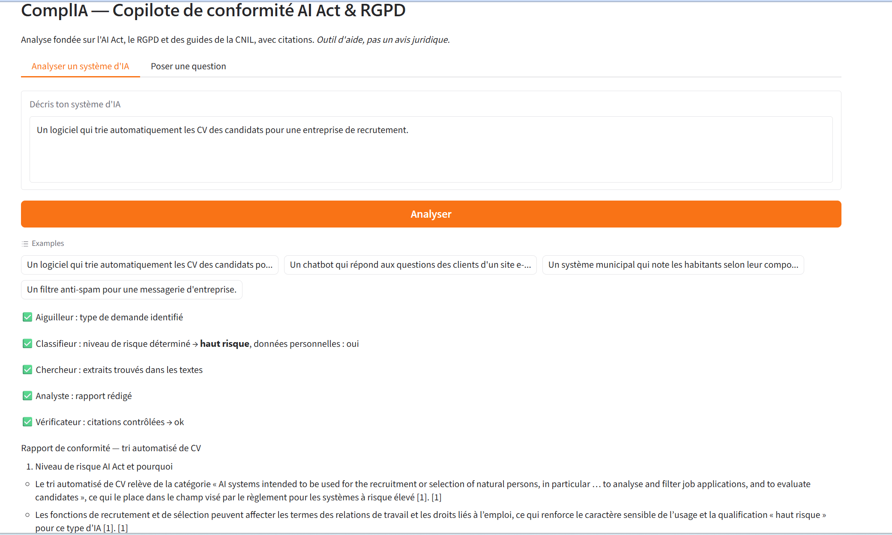
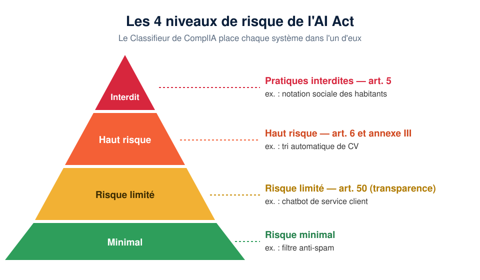
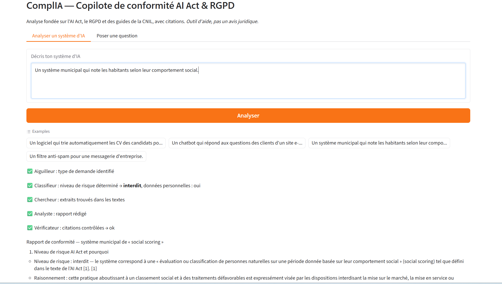
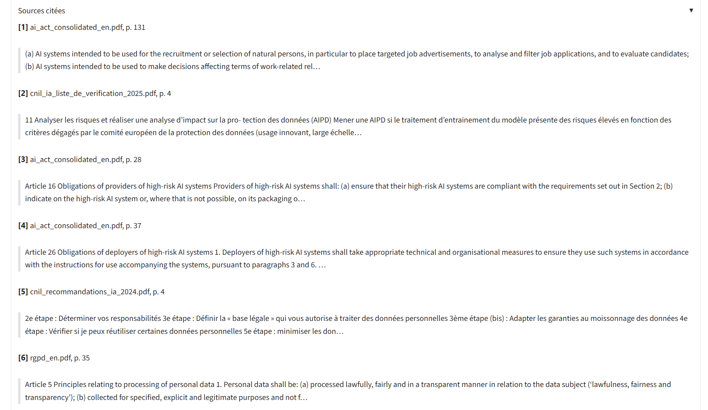
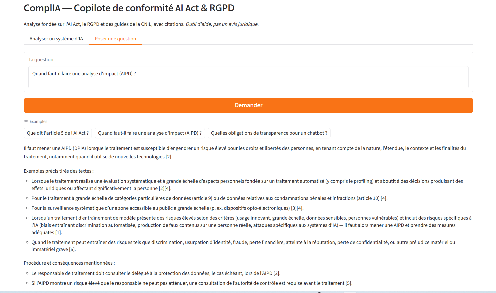
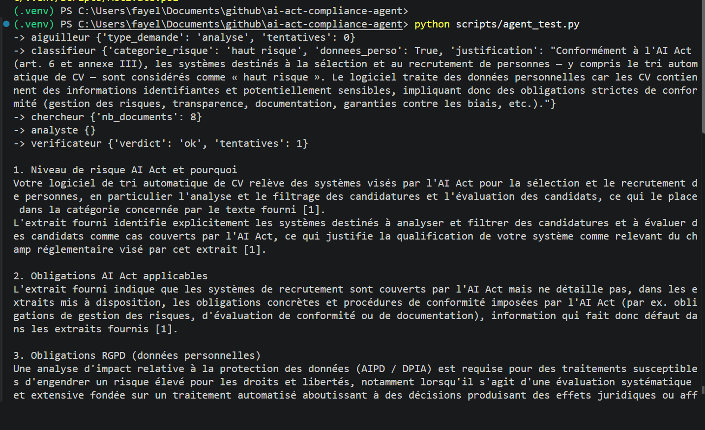
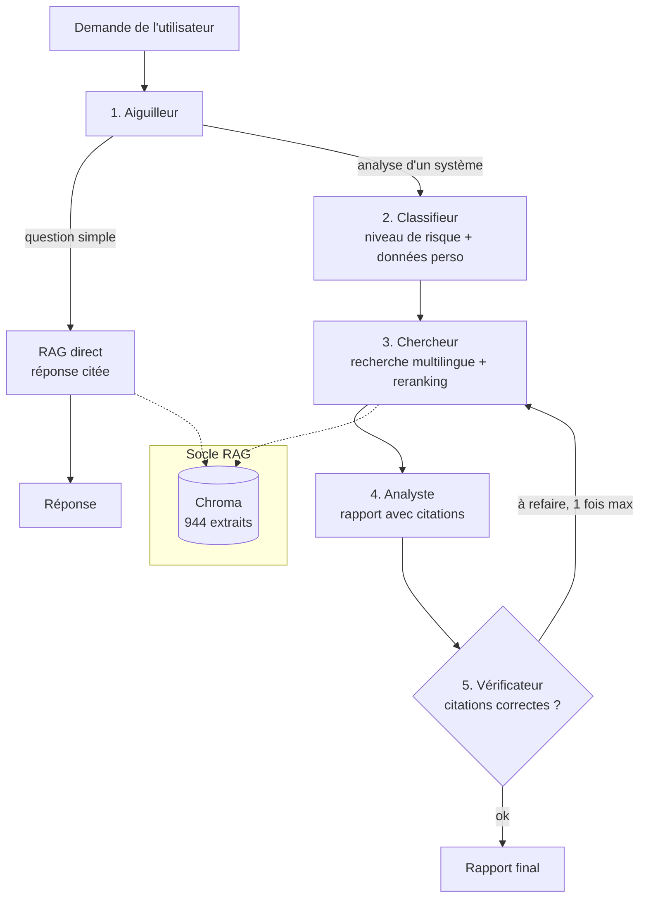

<p align="center">
  
</p>

<p align="center">
  
  
  
  
  
  
</p>

> **Décrivez votre système d'IA. ComplIA vous dit s'il est à haut risque au sens de l'AI Act, quelles obligations AI Act et RGPD s'appliquent, et cite les articles sur lesquels il s'appuie.**

<p align="center">
  
</p>

---

## Le problème

Depuis l'entrée en vigueur de l'**AI Act** européen, toute entreprise qui développe ou utilise un système d'IA doit savoir dans quelle catégorie de risque il tombe, et quelles obligations en découlent. Si le système traite des données personnelles, le **RGPD** s'ajoute.

<p align="center">
  
</p>

Les textes sont longs, en partie en anglais, et répartis entre plusieurs sources (règlements européens, guides de la CNIL). ComplIA les rend interrogeables en français, avec des réponses **sourcées**.

---

## Ce que fait ComplIA

### 1. Analyser un système d'IA

On décrit un système en une phrase. Cinq agents se relaient pour le classer, chercher les textes applicables, rédiger un rapport et vérifier les citations. Chaque étape s'affiche en direct.

Le classifieur distingue réellement les niveaux de risque. Par exemple, un système de notation sociale des habitants est classé **interdit** (article 5) :

<p align="center">
  
</p>

### 2. Vérifier chaque source

Chaque affirmation du rapport renvoie à un extrait numéroté `[n]`. Les extraits sont consultables avec le nom du document et la page :

<p align="center">
  
</p>

### 3. Poser une question sur les textes

Pour une question générale, ComplIA répond directement à partir des textes officiels, y compris les guides de la CNIL en français :

<p align="center">
  
</p>

### 4. Sous le capot

Le même travail, vu depuis le terminal, agent par agent :

<p align="center">
  
</p>

---

## Architecture



### Le socle RAG

| Étape | Ce qui se passe | Fichier |
|---|---|---|
| Ingestion | 4 PDF (AI Act EN, RGPD EN, 2 guides CNIL FR) découpés en **944 extraits** et indexés dans Chroma avec `text-embedding-3-small` | `scripts/ingest.py` |
| Recherche multilingue | La question en français est **réécrite** par le LLM pour retrouver aussi les passages des textes en anglais | `rag/retriever.py` |
| Reranking | Le LLM reclasse les extraits trouvés et ne garde que les plus pertinents | `rag/reranker.py` |
| Réponse | Réponse en français, chaque affirmation suivie de sa source `[n]` | `rag/answer.py` |

### Les agents (LangGraph)

| Agent | Rôle | Sortie |
|---|---|---|
| **Aiguilleur** | Distingue une question générale (« Que dit l'article 5 ? ») d'une demande d'analyse | `question` ou `analyse` |
| **Classifieur** | Classe le système dans l'un des 4 niveaux de risque de l'AI Act et détecte les données personnelles | réponse **structurée** (Pydantic) |
| **Chercheur** | Lance plusieurs recherches ciblées selon la classification (obligations du niveau de risque, RGPD si besoin), supprime les doublons, garde les 8 meilleurs extraits | extraits |
| **Analyste** | Rédige le rapport en s'appuyant **uniquement** sur les extraits fournis | rapport cité |
| **Vérificateur** | Relit le rapport et contrôle que chaque affirmation importante est citée et que la citation correspond. Sinon, renvoie au Chercheur (1 reprise max) | `ok` / `a_refaire` |

Les agents partagent un état commun (`agents/state.py`). Les sorties de l'Aiguilleur, du Classifieur et du Vérificateur sont contraintes par des schémas Pydantic (`with_structured_output`), ce qui rend le routage du graphe fiable.

### Le serveur MCP

ComplIA expose ses capacités via le **Model Context Protocol**. N'importe quel client compatible (Claude Desktop, Cursor, VS Code…) peut les utiliser comme outils :

| Outil MCP | Ce qu'il fait |
|---|---|
| `rechercher_textes` | Renvoie les extraits les plus pertinents de l'AI Act, du RGPD et des guides CNIL |
| `poser_question` | Répond à une question avec citations (RAG) |
| `analyser_systeme` | Lance l'analyse multi-agents complète d'un système d'IA |

---

## Stack

- **LLM & embeddings :** OpenAI `gpt-5-mini`, `text-embedding-3-small`
- **RAG :** LangChain, Chroma
- **Multi-agents :** LangGraph
- **Interopérabilité :** MCP (SDK Python officiel, FastMCP)
- **Interface :** Gradio
- **Langage :** Python 3.11

---

## Installation

```bash
git clone https://github.com/mfaye2/ai-act-compliance-agent.git
cd ai-act-compliance-agent

python -m venv .venv
# Windows
.venv\Scripts\activate
# macOS / Linux
source .venv/bin/activate

pip install -e .
```

Créez un fichier `.env` à la racine avec votre clé OpenAI :
```
OPENAI_API_KEY=sk-...
```

Construisez l'index (une seule fois) :
```bash
python scripts/ingest.py
```

## Utilisation

**Interface web (recommandé) :**
```bash
python -m complia.ui.app
```
Puis ouvrez http://127.0.0.1:7860

**Analyser un système d'IA en ligne de commande :**
```bash
python scripts/agent_test.py "Un chatbot qui répond aux questions des patients d'une clinique"
```

**Poser une question au RAG :**
```bash
python scripts/ask.py
```

**Tester le serveur MCP :**
```bash
python scripts/mcp_test.py
```

**Brancher ComplIA dans Claude Desktop :** ajoutez ceci dans `claude_desktop_config.json` (sous Windows : `%APPDATA%\Claude\claude_desktop_config.json`) en remplaçant le chemin et la clé par les vôtres, puis redémarrez Claude Desktop :
```json
{
  "mcpServers": {
    "complia": {
      "command": "C:\\chemin\\vers\\ai-act-compliance-agent\\.venv\\Scripts\\python.exe",
      "args": ["-m", "complia.mcp_server.server"],
      "env": { "OPENAI_API_KEY": "sk-..." }
    }
  }
}
```

---

## Structure du projet

```
ai-act-compliance-agent/
├── data/raw/                 # PDF sources (AI Act, RGPD, CNIL)
├── docs/images/              # images du README
├── scripts/
│   ├── ingest.py             # construit l'index Chroma
│   ├── search_test.py        # teste la recherche
│   ├── ask.py                # pose une question au RAG
│   ├── agent_test.py         # lance le graphe multi-agents
│   └── mcp_test.py           # client MCP de test
├── src/complia/
│   ├── config.py
│   ├── ingestion/            # chargement et découpage des PDF
│   ├── rag/                  # retriever, reranker, answer
│   ├── agents/               # state, nodes (5 agents), graph
│   ├── mcp_server/           # serveur MCP (3 outils)
│   └── ui/                   # interface Gradio
└── pyproject.toml
```

---

## Limites connues

- **Ce n'est pas un avis juridique.** ComplIA aide à se repérer dans les textes. Une analyse de conformité réelle doit être validée par un juriste.
- **Corpus limité** à 4 documents. Les actes délégués, les lignes directrices de la Commission et les normes harmonisées ne sont pas inclus.
- **Le Classifieur** décide à partir des connaissances générales du modèle. Les textes officiels n'interviennent qu'à partir du Chercheur.
- **La route « question simple »** ne passe pas par le Vérificateur. Le modèle peut alors associer un passage au mauvais article.
- Le Vérificateur est lui-même un LLM : il réduit les erreurs de citation, il ne les élimine pas.

## Feuille de route

- [x] RAG multilingue avec reranking et citations
- [x] Graphe multi-agents LangGraph avec boucle de vérification
- [x] Serveur MCP
- [x] Interface Gradio
- [ ] Déploiement en ligne de l'interface
- [ ] Vidéo de démonstration
- [ ] Transmettre au Chercheur le problème détecté par le Vérificateur
- [ ] Évaluation automatique de la qualité des réponses (jeu de questions de référence)

---

## Auteur

**Mouhamadou** — consultant IA freelance (RAG, agents, applications IA)  
GitHub : [@mfaye2](https://github.com/mfaye2)
